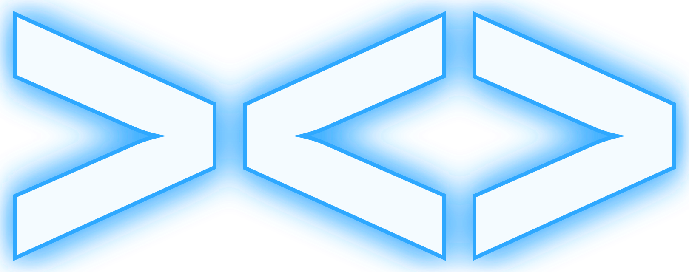
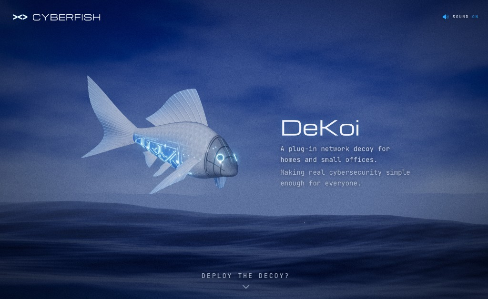
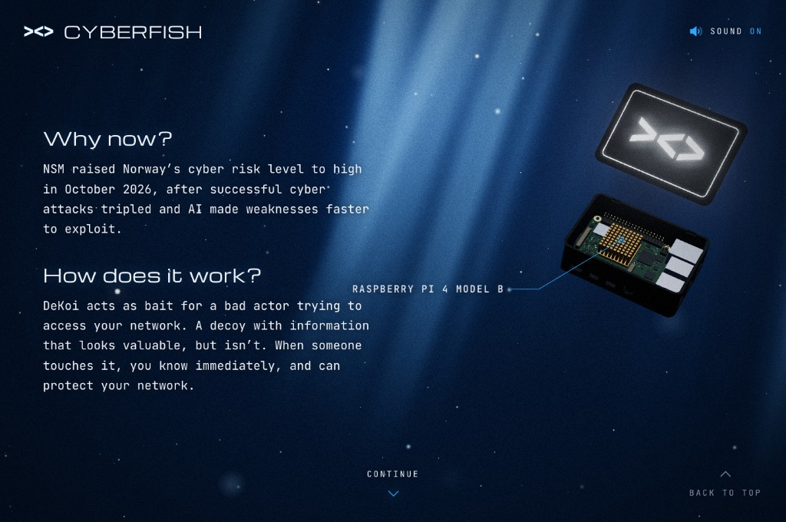
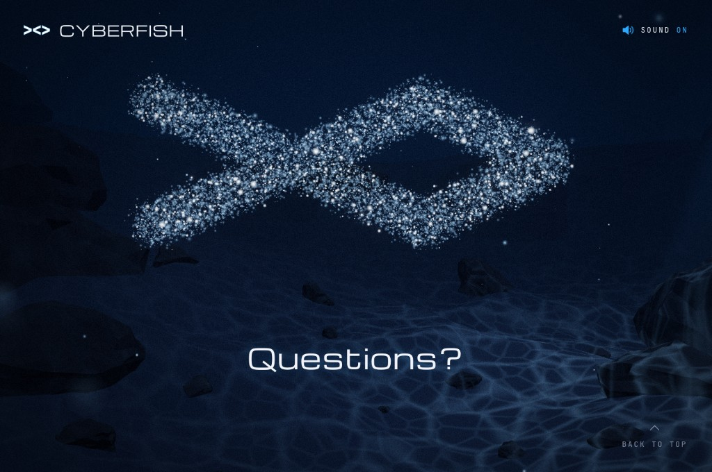

<p align="center">
  
</p>

<h1 align="center">DeKoi by CyberFish</h1>

<p align="center">
  A landing page you scroll down through, from the night sea to the sea floor.<br>
  Built at Oslo Sprint 2026 by team CyberFish.
</p>

<p align="center">
  
</p>

Single-page landing site for **DeKoi**, a small box you plug into your home or office network. It pretends to be a storage drive. If something touches it, you get an alert on your phone within a minute.

Inspired by my favourite three.js projects, DeKoi came to life in just under 24 hours thanks to Midjourney, Blender and Claude. Built from a separate repository as we considered it part of the presentation and an advertising asset rather than the product itself.

## The dive

The page is one continuous three.js scene. Each section is a chapter a little deeper in the water.

1. **Surface.** The CyberFish over a procedural night sea. *Deploy the decoy?* takes you under.
2. **Deep water.** Why now, and how it works, with the DeKoi box opening up to show the Raspberry Pi inside.
3. **Safety.** How DeKoi is built to be attacked, safely.
4. **Market.** DeKoi against the competition.
5. **Team.** The people behind CyberFish.
6. **Sea floor.** The CyberFish mark drawn as a swarm of particles, and room for questions.

<table>
  <tr>
    <td width="50%"></td>
    <td width="50%"></td>
  </tr>
  <tr>
    <td align="center"><sub>Deep water: the DeKoi box opens up</sub></td>
    <td align="center"><sub>Sea floor: the mark as a particle swarm</sub></td>
  </tr>
</table>

## Stack

- [Vite](https://vitejs.dev/) + TypeScript
- [three.js](https://threejs.org/) for the whole scene: procedural night sea (Gerstner waves), sky dome, underwater light rays and motes, the sea floor, glTF models and a bloom/grain post pass
- Plain CSS with design tokens (`src/ui/tokens.css`), no UI framework
- Fonts: Michroma and JetBrains Mono via Google Fonts

## Getting started

```bash
npm install
npm run dev        # http://localhost:5173
npm run build      # type-check, then build to dist/
npm run preview    # serve the production build
```

## Project layout

| Path | What it is |
|---|---|
| `index.html` | Page shell. Loader styles are inlined so the overlay paints before any script loads |
| `src/main.ts` | Entry point: boots the loader, scene and UI |
| `src/scene/` | three.js scene, one module per chapter (`ocean.ts`, `sky.ts`, `water.ts`, `deep.ts`, `safety.ts`, `floor.ts`, `logo.ts`), plus `fish.ts`, `post.ts`, `palette.ts` and GLSL shaders |
| `src/ui/` | Loader, audio, the hardware callout and CSS per section |
| `public/models/` | Shipped glTF models: the CyberFish (posed and straight), the DeKoi box and the sea floor |
| `public/sfx/` | Shipped sound effects and music used by `src/ui/audio.ts` |
| `public/*.svg` | CyberFish mark (flat and glow variants) |
| `assets-src/` | Blender sources and Python build scripts for the fish, ocean, DeKoi box and sea floor, plus reference renders |
| `SFX/` | Original audio files before renaming/copying into `public/sfx/` |
| `docs/screenshots/` | Screenshots for this README |
| `reference/` | Brand tokens, build brief and visual references. Read, don't ship. `reference/visual-refs/` is gitignored |

## Assets and credits

- **3D models and scenes**: the CyberFish, the ocean, the DeKoi box and the sea floor were generated procedurally in Blender (see `assets-src/*/README.md` for how to regenerate them). Concept imagery came from Midjourney.
- **SFX**: from ElevenLabs libraries.
- **Background music**: *Digital Horizons*, licensed from [premiumbeat.com](https://www.premiumbeat.com/).
- **Fonts**: Michroma and JetBrains Mono, served from Google Fonts.

## Brand

Colours, typography, logo rules, voice and product facts live in `reference/BRAND.md`. Every CSS value and line of copy should trace back to it.
